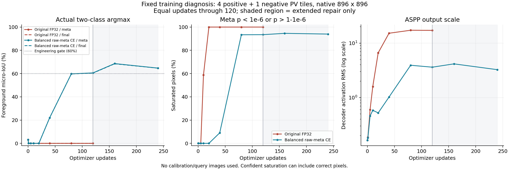
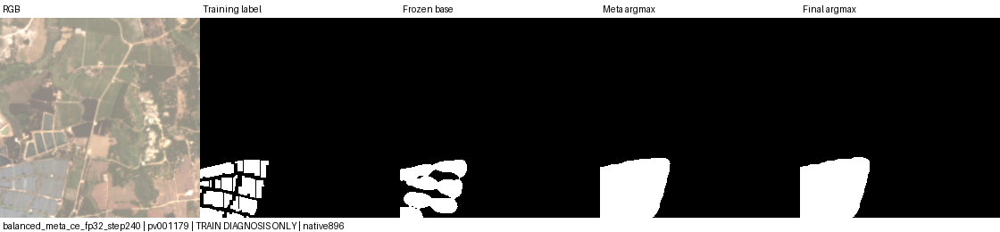
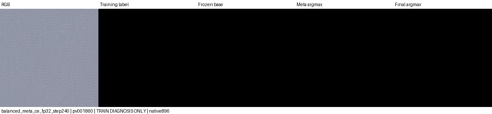

# A3 下游全背景诊断

本轮只做训练侧定位，不读取校准或查询影像。复用 A3 learned v2 的基础网络，固定原训练划分的 4 张正图与首张负图，支持取该查询允许的首张非重叠正图，原生 896×896、无增强。

先检查旧 selected.pt 的 AMP/FP32 输出和各损失的梯度，再从相同随机初始化、相同 RNG、相同 episode 序列各训练 120 次。原结构、四项损失、AdamW lr=1e-4、weight decay=1e-4、梯度裁剪 10 均保持一致；只有混合精度与 FP32 不同。两组均启用相同 Dropout，评测时关闭。

记录中间特征尺度、base/meta/final 的逐图混淆像素、前景/背景概率、饱和比例、前景面积、logit 差，以及各模块梯度范数。独立记录 CE/meta Dice/pseudo BCE/spatial Dice 对预测头、解码器、注意力和 DMSF 的梯度。FP32 的小于半精度误差不等于解释收敛失败，须结合实际输出判断。

入口 `scripts/kaggle_a3_diagnosis.py`。诊断过拟合结果不是验证精度；若修改归一化、头初始化或损失，须作为适配方案单独记录并保留本轮原模型对照。门槛沿用工程检查：固定训练样本 final/meta 前景 micro-IoU 至少 0.60、每张正图有 TP、损失下降，同时报告负图误报。

## 原模型诊断结果

私有 [Kaggle diagnosis v1](https://www.kaggle.com/code/zh0416/pv-a3-head-diagnosis) 已完成，源码 `d399b38f64aa3aec98e1990ffb75ca6aceae5fa3`，Tesla T4 / Torch 2.11。两臂各完成 120 次更新，36 项检查通过；完整小报告见 [原模型证据](experiments/a3_head_diagnosis_20261029/original/summary.json)。

| 训练侧检查 | AMP | FP32 |
| --- | ---: | ---: |
| 冻结 base 前景 micro-IoU | 72.68% | 72.68% |
| 原初始化 meta/final IoU | 3.25% | 3.25% |
| 更新 1 次的 meta/final IoU | 0 | 0 |
| 更新 120 次的 meta/final IoU | 0 | 0 |
| 平均诊断损失（初始→120） | 1.52408→0.80204 | 1.52408→0.80251 |

以固定正图 `pv001179` 的 FP32 路径为例：初始 decoder RMS=0.165、meta logits RMS=0.0617；step20 分别增至 6.616、48.233，前景减背景 logit 范围为 [-104.77,-16.06]，所有像素前景概率低于 1e-6，预测头总梯度 RMS=1.26e-11。step120 meta logits RMS=160.03，margin 范围 [-351.53,-46.22]，预测头与 decoder 的梯度 RMS 均为 0。旧 selected.pt 同样饱和，改用 FP32 推理不能恢复。

这说明当前失效发生在 meta 分支、早于最终 base/meta 合并；不能归因于 AMP。meta softmax 饱和后，经过该 softmax 的 final CE 与 meta Dice 都无法提供足够纠错梯度。CNN 特征初始尺度有限，没有发现输入 NaN；ASPP/头的尺度在训练中快速增大。注意力 Q 的梯度也很小，仍是待研究项。以上定位的是观察到的失效机制，不证明唯一根因，更不能据此否定论文方法。

## 最小修正方案与完成结果（2026-10-30 核验）

保留原模型、初始化、训练数据、episode、Dropout、优化器及四项原损失，只额外加入系数 1 的 **balanced raw-meta CE**：对每个 episode 分别计算前景/背景像素的平均交叉熵，再对存在的类别等权平均；纯负图只计算背景项。直接使用 meta 原始 logits，避开饱和 softmax 对该项梯度的衰减。它属于光伏适配改进，不能标成原文损失。

本地新增回归检查：极度错误饱和时仍有前景纠错梯度；复制背景像素不会稀释前景权重；纯负图结果有限且等于普通背景 CE。全部 39 项检查通过。原 `objective()` 默认权重为 0，默认行为保持四项损失。

私有 [Kaggle head repair v1](https://www.kaggle.com/code/zh0416/pv-a3-head-repair) 已完成，源码 `c0ab5caa828725f1481885ca721a35002944fe5a`。相同 5 张训练图、FP32、240 次实际更新、39 项检查全部通过。第 120 步与原模型等更新数比较，第 240 步只作为延长诊断。step0 各图 base/meta/final logit 差的均值、标准差、最小与最大值与原 FP32 报告差异均为 0；pairs 和前 120 步 episode 序列一致。只使用训练侧指标，不读取校准/统计查询影像。运行参数：`--meta-ce-weight 1 --steps 240 --output /kaggle/working/a3_head_repair`。

| 固定训练侧结果 | 原四项损失 FP32，120 步 | 加 balanced raw-meta CE，120 步 | 加 balanced raw-meta CE，240 步 |
| --- | ---: | ---: | ---: |
| meta 前景 micro-IoU | 0% | 60.59% | 64.72% |
| 最终 mask 前景 micro-IoU | 0% | 60.43% | 64.65% |
| 最终 mask 前景召回率 | 0% | 100.00%（漏 1 像素） | 100.00% |
| 最终 mask 精确率 | 无前景预测 | 60.43% | 64.65% |
| 5 图全部背景像素的误报率 | 0% | 2.20% | 1.84% |
| 单张纯负图 `pv001860` 误报像素 | 0 | 0 | 0 |
| 四张正图均有 TP | 否 | 是 | 是 |
| 预定工程门槛 | 未通过 | 通过 | 通过 |

冻结 base 在同一组图上的 IoU 为 **72.68%**，高于修正后最终 mask。修正臂自身平均评测损失为 2.22408→0.48838；由于增加了损失项，不能把它与原臂的总损失值直接横比。240 次训练的损失、梯度和记录的中间张量均有限，没有跳过更新。step160 最终 IoU 为 68.41%，step240 为 64.65%，并非单调改善；本诊断按预定上限结束，没有用训练曲线挑选最佳检查点。

240 步最终输出逐图检查：

| 查询图 | 前景 IoU | TP 像素 | FP 像素 | FN 像素 |
| --- | ---: | ---: | ---: | ---: |
| pv001179 | 65.61% | 47,718 | 25,013 | 0 |
| pv001181 | 65.23% | 54,613 | 29,117 | 0 |
| pv003492 | 62.29% | 14,185 | 8,586 | 0 |
| pv003494 | 61.88% | 14,185 | 8,738 | 0 |
| pv001860（无光伏） | 无前景并集，不定义 IoU | 0 | 0 | 0 |

### 梯度与预测图说明了什么

在旧失败检查点的同一正图 `pv001179` 上，原 final CE/meta Dice 对预测头的梯度 RMS 都为 0；新增 raw-meta CE 为 16.17，表明该项确实提供了饱和后的纠错梯度。但本次训练是**从相同随机初始化重新开始**，没有证明直接续训旧失败检查点就一定能恢复。

修正臂 step240 在该正图上的预测头总梯度 RMS 为 0.01352、decoder 为 0.000703；decoder 激活 RMS 为 2.996，原臂 step120 为 17.067。其大部分像素的 meta 概率仍接近 0 或 1，但现在包含正确的前景和背景，不能把“饱和比例高”直接等同于全背景塌缩。attention Q 梯度仍很小；本次没有证明 DCMA 或 DMSF 比其他组件更有效。

正图示例，从左到右为 RGB、训练标签、冻结 base、meta 与最终 mask。修正后能找到光伏区域，但阵列间隙被填平、轮廓偏粗，仍有明显过分割。

### 当前结论与下一步

**当前损失改动已让这个固定训练诊断摆脱全背景并通过工程门槛，尚未证明完整 A3 的泛化效果。** 只有一次初始化、4 正 1 负，负图是水面，没有覆盖用户指出的大棚和复杂建筑；原臂没有运行到 240 步，240 步结果必须与等步数对照分开解释。这是光伏有监督适配改进，不能算原文损失的复现，更不能拿训练侧 64.65% 与 A2 的查询侧 44.05% 比较。

下一项实验应回到已锁定的 22 张训练图（4 正 18 负），使用显式的修正损失与 FP32；按完整分割输出在校准集上选模型，随后固定模型和阈值评估原 58 张统计查询及 2 张预览、三组支持。重点分别报告大棚／建筑误检、前景边界和支持敏感性，并保留 A2、旧 A3 与冻结 base 对照。在该验证前不继续堆叠模块。本轮修正仍通过 `objective(..., meta_ce_weight=1)` 和诊断入口显式启用；通用 `scripts/sspnet.py` 默认仍为原四项损失，不能把诊断检查点当作其可直接恢复的正式训练检查点。

原始报告见 [修正结果汇总](experiments/a3_head_diagnosis_20261029/balanced_ce/summary.json)、[逐步对照与门槛核验](experiments/a3_head_diagnosis_20261029/comparison.json) 和 [初始化核对](experiments/a3_head_diagnosis_20261029/balanced_ce/initialization_comparison.json)。运行 `python docs/experiments/a3_head_diagnosis_20261029/build_comparison.py` 可由已归档报告重建对照 JSON 与曲线，无需原始数据或权重。

原始数据、冻结特征、权重和 checkpoint 留在 Kaggle。本地和 GitHub 只保存小型报告、源码及派生预览。
