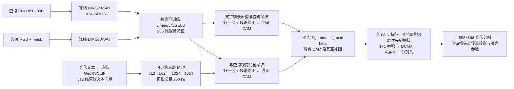

# A3 修正：可学习的 DMSF 先验与下游训练

旧 A3 是冻结编码器的固定响应融合，只能作为 `A3_FIXED` 对照。它没有训练跨模态投影，不能代表论文的 DMSF。原记录及数字保留；大棚背景误检增加是明确失败，不能用总体 IoU 上升掩盖。

## 原文与修正后的实现

论文第 4–6 页的核心是先学习可比较的表示，再构建互补 CAM，并将融合 CAM 作为下游先验。论文 Eq.5 也采用加权相加，但权重和前面的映射层由任务损失学习；不是把两个冻结响应手工混合。

`beta` 初始为 0.7，初始空间权重为 sigmoid(0.7)≈0.668。它是全局可学习标量，不是逐像素门控。语义 CAM 来自 **DINO 查询特征与映射后的文本**，不再使用 GeoRSCLIP 图像滑窗的分数充当该 CAM。语义图、空间图和融合图都是先验；阈值化先验仅用于诊断，最终分割由完整下游网络产生。

图像与文本编码器冻结。第一阶段训练 ResNet-50/PSPNet；第二阶段冻结该基础分割器，训练 DMSF、特征组装、DCMA、ASPP、meta 头及 base/meta 融合。目标保持 `CE_final + Dice_meta + 0.2 BCE_pseudo + 0.04 Dice_spatial`。不另外加一个可以绕开下游的语义 CAM 监督。

## 数据与比较范围

沿用历史 3 张独立支持图、12 张校准图、58 张统计查询与 2 张仅预览图。三次推理只改变支持图，训练随机种子固定；不是三次独立训练或集成。

新增训练只使用历史支持空间组 `0910_Q_f31b2f78ddfe4a`。排除三张保留支持图、用户指定图及其重叠/同哈希切片，并要求训练 episode 的查询与支持不相交。两个无法匹配非重叠前景支持的候选 `pv001178/pv001180` 在两阶段均排除。得到 22 张额外训练图：4 张有前景（`pv001179/pv001181/pv003492/pv003494`）、18 张负样本。划分摘要 SHA256 为 `ed6bfed52e00a484d95c1b272582be5bc1f88634907adea2dea7c38163b59d54`。

校准组与所有查询组整组禁止训练。训练仅一个空间组，组内 episode 允许同场景但不得重叠；这有别于此前跨场景 episode 和论文的新类少样本协议。它是**已知光伏类、有额外像素标注的开发实验**。与零训练 A2 的结果是描述性比较，不能归因于融合结构一项；联合训练后的两个单独 CAM 也不属于独立消融实验。

## 固定训练与选择规则

- 原生 896²，无缩放或数据增强；正负查询交替、组内均匀采样，episode 配对固定 seed42。
- 基础分割器 160 次 SGD 更新，学习率 0.005，poly 衰减，batch1，冻结 BN 统计。
- 第二阶段 320 次 AdamW 更新，学习率 0.0001，权重衰减 0.0001，梯度裁剪 10。此优化器选择明确不同于原文 SGD，是有界开发训练，不声称复现原文训练日程。
- 每 80 次更新只用校准组，按三种保留支持选择的融合先验 micro-IoU 均值选 checkpoint；并列选更早更新。每个方法/支持的阈值在校准组用 4096 桶最大 IoU 确定，并列选更高阈值。查询标签仅在选择完成后用于统计。
- 同时报告校准阈值的最终分割，以及固定 0.5 最终概率阈值（对应二类 argmax）；不能用先验图的成绩代替最终网络成绩。

## 工程检查与结果判定

缓存只存冻结编码器的 FP32 输出；所有可训练投影、支持池化、CAM 和下游模块每步重新执行。直接 RGB 与缓存路径的输出等价以及完整下游损失回传均有测试。训练记录有限损失、梯度、参数变化和成功更新次数；关键文本/视觉/融合路径没有实际更新即失败。仍须通过真实 GPU 实验核实，不能凭单元测试宣称效果正确。

逐图复算 A2 的阈值与混淆像素计数，要求与历史完全一致。报告三种支持下的 IoU、精确率、召回率、背景误检率、负图误检、面积/背景/形态分组，以及固定尺度的空间/语义/融合 CAM 和最终 mask。重点检查大棚、复杂建筑，警惕以牺牲召回换取误检下降。原完整网络曾全背景塌缩，本次仍需检查。

运行入口 `scripts/kaggle_a3_learned.py`；数据、权重、checkpoint 与临时特征留在 Kaggle。GitHub 保存源码、配置和说明；本地仅取报告及派生预览。

**当前状态：代码及本地检查完成，等待本次 Kaggle 实测。** 后续以运行记录更新，不预写改善结论。
