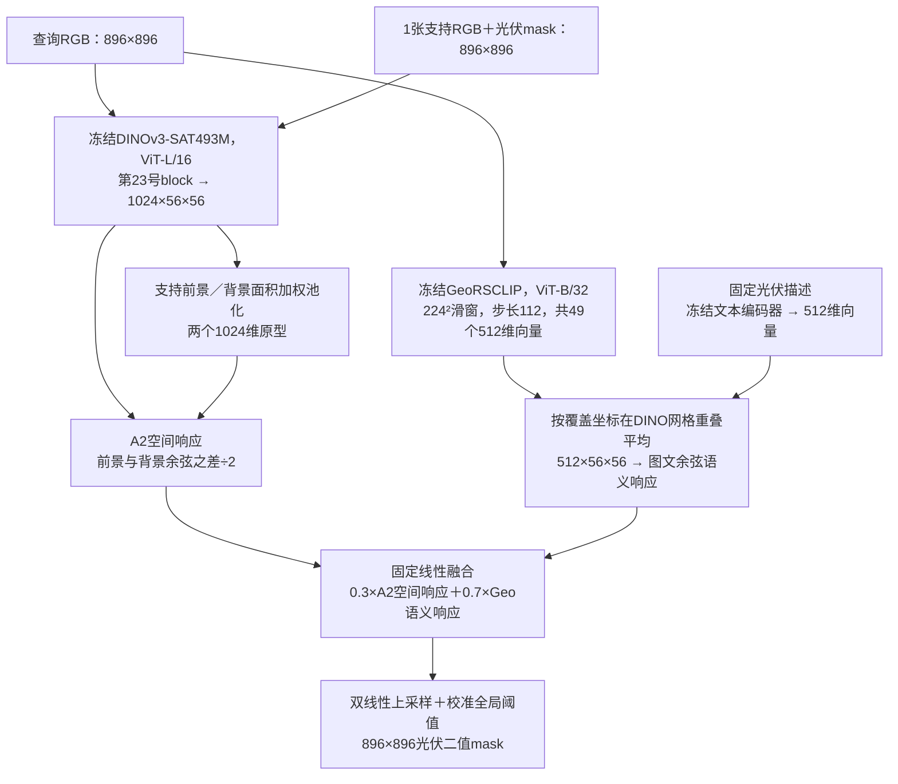

# A3 光伏融合实验结果（2026-10-29）

**A3已在Kaggle完成。三次独立1-shot的平均前景IoU从A2的44.05%升至47.55%，提高3.50个百分点；复杂建筑误检明显减少，但大棚误检仍然严重，部分样本进一步扩大。** 本轮支持“融合对部分场景有帮助”，尚不支持“已经解决背景混淆”。

## 本次结构与输入输出

支持分支的DINO特征经支持mask得到原型；查询分支特征与这些原型比较。查询mask只用于评价，不输入推理或权重选择。

| 部分 | 作用／实际处理 |
|---|---|
| DINOv3-SAT空间分支 | 完整沿用A2，根据一张支持图的光伏和背景外观定位查询像素；使用SAT专用归一化 |
| GeoRSCLIP语义分支 | 完整沿用A0的图像、文本编码器、QuickGELU和固定prompt，判断局部窗口与光伏描述的相关性 |
| 空间对齐 | 将224²窗口向量赋给对应的14×14个DINO格点，步长7格；重叠平均后保持原值，不再次L2归一化 |
| 固定融合 | 分别在各自特征坐标中读出空间、语义分数，再线性相加；等价于分块拼接特征的线性读出 |
| 阈值分割 | 三次支持各有一个阈值；恢复896²分数后输出二值mask，分数不解释为概率 |

**本轮完成的是空间坐标对齐与固定响应融合，没有训练DINO和CLIP的共同语义映射。** 1024维和512维特征不逐通道相加；等价分块特征公式见[A3协议](A3_PROTOCOL_20261029.md)。实现直接计算等价标量读出，避免物化1536通道张量。原始CLIP窗口的感受范围仍为224²，对齐和插值不会创造精细边界。

## 对照与权重如何确定

沿用A0/A1/A2的三个支持选择：`pv001183`、`pv003504`、`pv001177`，分别作为run42/43/44的一张支持。58张查询包含51张正图、7张负图；原12张校准图及空间角色不变。`pv000137`仍因Excel与标签前景存在冲突、`pv001191`仍因与校准组同空间组，仅输出预览，不计入指标。

每次实际使用**1张支持mask＋12张校准mask**，三个支持独立运行，不集成。候选语义系数在查询结果产生前固定为`0,0.1,…,1.0`。每个候选在校准组分别选择三个最大micro-IoU阈值，再按三次校准IoU的均值选择一个共享系数；平局优先更小语义系数。选中`alpha=0.7`，三个阈值分别为`0.189453125`、`0.19189453125`、`0.20849609375`。

| 语义系数alpha | 三次平均校准IoU（%） |
|---|---:|
| 0.0（退回A2） | 19.81 |
| 0.5 | 39.24 |
| 0.6 | 45.66 |
| **0.7（选中）** | **49.03** |
| 0.8 | 48.04 |
| 0.9 | 44.03 |
| 1.0（仅对齐后Geo） | 37.49 |

完整11个候选及各次阈值保存在`fusion_selection.json`。权重和阈值均使用同一批校准标签，因此校准IoU不能当作无偏验证结果。查询标签未传入权重选择函数，查询结果产生后没有重调prompt、权重或阈值。`0.7`只是当前分数尺度下的系数，不能解释为语义提供了70%的实际贡献。

同次Kaggle运行重算A0、三次A1和三次A2；**60张影像的所有对照TP/FP/FN/TN、阈值及汇总指标与历史完成版本完全一致**。原图与标签hash、数据角色、标签观察及空间审计也一致。

## 总体结果

以下均为百分数；每次先按58张查询累加TP/FP/FN，再对三个支持选择取算术平均。IoU为前景micro-IoU，不是前景／背景两类mIoU。AP为4096分箱近似像素AP。

| 方法 | 前景IoU | Precision | Recall | 像素AP | 负图误报像素率 |
|---|---:|---:|---:|---:|---:|
| A0：原生GeoRSCLIP | 28.92 | 36.35 | 58.56 | 41.44 | 4.4643 |
| GeoAligned：仅空间对齐Geo | 29.09 | 36.62 | 58.60 | 41.65 | 4.4541 |
| A1：三次均值 | 40.52 | 73.78 | 46.92 | 64.74 | 0.8377 |
| A2：三次均值 | 44.05 | 68.33 | 55.42 | 67.88 | 2.4021 |
| **A3：三次均值** | **47.55** | **62.69** | **66.32** | **66.86** | **1.6731** |

| 支持选择 | A2 IoU | A3 IoU | 变化（百分点） | A3 Precision | A3 Recall | A3负图有任意误报 |
|---|---:|---:|---:|---:|---:|---:|
| pv001183：run42 | 49.08 | 49.98 | +0.90 | 64.32 | 69.17 | 4/7 |
| pv003504：run43 | 41.12 | 45.66 | +4.54 | 62.38 | 63.01 | 2/7 |
| pv001177：run44 | 41.95 | 47.02 | +5.07 | 61.37 | 66.78 | 3/7 |

三次查询micro-IoU均提高，但并非每张图提高。相对A2，51张正图的提高／下降／相同数量分别为run42的28/22/1、run43的28/19/4、run44的28/21/2。平均F1为64.44%，高于A2的61.08%；IoU总体标准差从3.57降至1.81个百分点，只描述这三个支持选择的离散程度，不代表统计显著。

相对A2，平均Recall提高10.90个百分点，Precision下降5.65个百分点，AP下降1.02个百分点。负图误报像素率从2.40%降到1.67%，但**全部查询图中真实背景像素的平均误报率从2.83%升到4.35%**。二者统计范围不同：前者只看7张无光伏图，后者还包含有光伏图内的背景。不能把负图改善写成全面抑制背景。

## 大棚与复杂建筑：分别看误检

下表只统计对应正图。每个组先按像素汇总，再对三个支持取均值；背景误报率为`FP/(FP+TN)`。

| 正图组 | 张数 | A1 IoU | A2 IoU | A3 IoU | A2 → A3 Precision | A2 → A3 背景误报率 |
|---|---:|---:|---:|---:|---:|---:|
| 大棚干扰 | 11 | 52.59 | 41.41 | 44.17 | 53.27 → 47.76 | **7.37 → 11.85** |
| 建筑复杂 | 4 | 31.55 | 18.97 | 43.89 | 59.63 → 89.82 | **0.6825 → 0.1174** |

**复杂建筑有改善，大棚误检没有解决。** 大棚正图Recall从65.28%升至85.41%，IoU增加2.76个百分点，但FP像素总量按三次平均增加约60.88%，且IoU仍低于A1。其收益主要伴随更多前景找回，不能称为成功消除大棚误报。建筑正图Recall从23.69%升至46.36%，同时背景误报减少，但该组仅4张，也仍有完全漏检的样本。

无光伏负图的直接证据如下，数值为run42误报像素占全图比例：

| 影像 | 背景 | A2 | A3 | 核看结论 |
|---|---|---:|---:|---|
| pv001637 | 建筑复杂 | 7.2543% | 0% | 原先建筑区域误报消失；其余两次A3也为0 |
| pv001352 | 建筑复杂 | 0% | 0% | 保持空预测；run43从1.176%降至0 |
| pv001303 | 大棚干扰 | 1.5636% | 0.4001% | 这张大棚图误报减少 |
| pv001381 | 大棚干扰 | 7.3762% | 11.2756% | 大棚区域误报扩大；其余两次同样扩大 |

因此即使同为“大棚”，效果也不一致。7张负图太少，不能据此估计部署误报率。

## 其他分组与失败结果

| 正图背景／条件 | 张数 | A2 IoU | A3 IoU | 变化（百分点） |
|---|---:|---:|---:|---:|
| 普通 | 21 | 60.07 | 57.63 | −2.44 |
| 背景混乱 | 5 | 23.02 | 13.60 | −9.43 |
| 影像模糊 | 4 | 31.82 | 38.42 | +6.60 |
| 薄云干扰 | 3 | 36.46 | 51.66 | +15.20 |
| 阴影干扰 | 2 | 39.63 | 47.65 | +8.02 |
| 小目标光伏 | 1 | 32.24 | 17.99 | −14.25 |

| 面积组 | 张数 | A2 IoU | A3 IoU | A2 → A3 Recall |
|---|---:|---:|---:|---:|
| 大 | 23 | 55.13 | 56.89 | 61.44 → 72.06 |
| 中 | 10 | 25.42 | 25.67 | 35.92 → 42.57 |
| 小 | 18 | 28.66 | 41.04 | 47.24 → 65.77 |

18张“面积小”整体改善，但背景字段“小目标光伏”的单张样本退化，6张“零碎板块”形态组IoU也从21.68%降到15.53%。这些是不同分组，不能相互替代。小组数字仅用于排查，不作稳定的泛化结论。

## 预测图与浏览方法

全部60张图在[本地对比浏览页](E:/PVdataset/PV-DINOV3/outputs/a3_20261029/index.html)，可按背景、面积、正负图筛选，也可按run42的A3 IoU或相对A2变化排序。八列依次为RGB、真值、A0响应、A1掩膜、A2响应／掩膜、A3响应／掩膜。预览只展示run42，其余两次完整指标见[逐图CSV](E:/PVdataset/PV-DINOV3/outputs/a3_20261029/per_image.csv)。

各方法热图使用各自校准组固定1%–99%色标，颜色不等于概率；不能直接跨方法比较颜色强度。图像是派生缩略预览，指标在原始896²分辨率上计算。

| 代表样本 | run42 A2 → A3 | 图像核看 |
|---|---|---|
| pv000214：建筑复杂正图 | IoU 31.74% → 73.53% | 光伏找回增多，背景误报减少 |
| pv001112：模糊 | IoU 41.52% → 52.16% | 阵列更完整，仍混入背景 |
| pv000133：小面积零碎 | IoU 7.46% → 21.15% | 找回部分光伏，大部分仍漏检 |
| pv000163：大棚干扰正图 | IoU 14.36% → 13.11% | 找回更多光伏的同时，大棚等背景误报扩大 |
| pv000450：建筑复杂正图 | IoU 3.17% → 0% | A3完全漏检，保留这项反向证据 |
| pv001006：薄云 | IoU 85.56% → 83.46% | Recall提高，但额外背景使IoU略降 |
| pv001097：薄云 | IoU 3.70% → 8.82% | 仍有大量漏检，未解决该样本 |

## 结论与后续研究

固定语义融合改善了平均IoU、召回以及部分建筑背景，说明空间外观与图文语义存在一定互补；但单一光伏prompt和224²窗口仍可能对类似规则纹理产生高响应。大棚失败与这一限制相符，当前实验尚未独立分离验证具体成因。仅空间对齐的Geo IoU为29.09%，接近原A0的28.92%，没有证据把主要收益归给插值平滑本身。

建议保留A1/A2/A3三组。后续按实验表进入A4前，应明确动态校准或可学习映射究竟改变哪一项；只在训练／校准空间组选择设置，以大棚FP、整体Precision和光伏Recall一起作为判据。困难背景原型或“光伏／大棚／屋顶”竞争语义可以另作独立消融；不应根据当前查询图逐张改阈值或将多项改动混成一个结论。

本批为人工筛选且反复查看的开发诊断集，需要新空间区域测试才能评估泛化。**本轮为冻结A3，0次梯度更新；没有学习共同语义空间、没有启用A4，也不代表原论文SSPNet完整训练与基准复现。**

## 运行、代码与核验

- 私有[Kaggle运行](https://www.kaggle.com/code/zh0416/pv-a3-selected-check)，Version 1，状态COMPLETE；运行源码`632c5e07b41d483f27d9ffab7a8f9c70054a368d`。
- 环境：Tesla T4、FP32、torch 2.11.0+cu128、timm 1.0.29、open_clip_torch 3.2.0、numpy 2.1.3；峰值CUDA allocated约1.30GiB，不是整卡占用。
- 7项数值单元检查在Kaggle通过；新增检查覆盖窗口特征坐标、重叠平均图文响应等价性、分块特征读出等价性、融合端点及校准选择。真实数据空间对齐最大绝对误差为`1.1920928955078125e-07`，小于预设`2e-6`。
- 本地核验通过：660组影像／方法混淆计数、汇总及CSV一致；60张PNG可解码；历史A0/A1/A2对照一致；校准／查询无ID交叉，权重、阈值、三次均值与标准差一致。通过这些检查不等于代码不存在任何潜在问题。
- 本地结果目录：`E:/PVdataset/PV-DINOV3/outputs/a3_20261029/`，包含`summary.json`、`analysis.json`、`per_image.csv`、`fusion_selection.json`、`thresholds.json`、`reference_reproduction.json`、`result_integrity.json`及浏览页。
- 复核命令：`python -m scripts.summarize_a3 outputs/a3_20261029 --reference01 outputs/a0a1_20261029 --reference2 outputs/a2_20261029`。原始影像、label、权重和特征仍在Kaggle；本地仅取回报告和派生预览，预览不提交公共GitHub。
