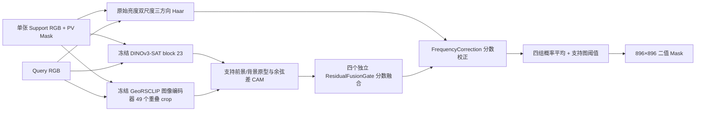
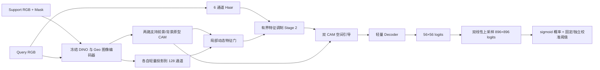

# 双先验小样本光伏分割：Stage 0 审计与架构设计

状态：仅完成静态审计与设计。Stage 1–4 尚未实现、训练或验证。基线快照为 `c8b393c`，分支 `codex/pv-dual-prior-feature-fusion`。

## 1. 当前真实数据流与结构

入口 `scripts/kaggle_pv896_support_haar_fusion.py:47`：从清单取 `pv001183` 的 896×896 RGB/mask；查询为固定 300 张，三类各 100 张。DINO 从第 23 块取 `1×1024×56×56`，Geo 将 49 个 224×224、步长 112 的 crop 图像向量平均铺到 `1×512×56×56`。Geo 的每个网格向量来自覆盖该位置的 crop，位置边界按 16 像素整除，不能解释为独立的 16×16 Geo patch 特征。没有调用 `encode_text`。编码器在 `no_grad` 下运行，输出转 CPU。

`pvseg/support_haar_fusion.py:39` 用支持 Mask 的 `area` 下采样目标，对两类分别求单位特征的加权均值再单位化。分母按各自面积除，故类别数量不直接压低少数类原型幅值；但仅一个前景和一个背景原型无法表达混杂背景，Geo crop 的跨边界混合也会污染局部原型。`pvseg/frozen_baselines.py:31` 的 CAM 为半个前景/背景余弦差，范围约 `[-1,1]`；不是文本 CAM。

`pvseg/support_haar_fusion.py:13` 的 Haar 输出 `1×6×56×56`：每个 16×16 原始亮度块计算两个递归尺度的水平、垂直、对角高频能量，取 `log1p(1000×均方)`，每通道按单图空间均值/标准差标准化。它提供局部纹理能量而非光伏专属语义。`FrequencyCorrection` 把它用于有界分数增量，没有改变两路深层特征。四组交错 patch 各留出 1/4，其余 3/4 构建原型并算平衡 BCE＋0.5 Dice；四组各自初始化、训练、保存。查询时四组概率平均，双线性上采样后阈值化。

## 2. 已确认的基线风险

1. **P0 阈值索引错误。** `pvseg/support_only_segmenter.py:50-65` 将直方图逆序累积后取最大 IoU 的 `best`，却返回正序 `edges[best]`。应映射回原方向，如 `edges[bins-1-best]`，并通过独立数值测试确认边界包含规则。最新记录返回 0.3154296875，而该索引搜索的概率边界约 0.684326171875。旧 300 图 IoU 20.96%、Precision 21.62%、Recall 87.31% 属于错误阈值下的真实计数，修复后指标未知。Stage 1 不继承该阈值选择；旧基线若重评需先单独修复和重算。
2. **P0 支持内部验证不独立。** `pvseg/support_haar_fusion.py:108-164` 用相邻交错 patch 留出，编码器感受野及 Geo 重叠 crop 共享邻域信息；留出概率拼接后又双线性上采样，邻近训练 patch 的模型输出会混入像素阈值搜索。支持内部 65.02% IoU 不能作为跨场景验证。
3. **P1 校准与查询聚合不同。** 支持侧每格只使用其留出模型；查询侧每格平均四组模型，二者概率分布可能不同。Stage 1 用单组模型和固定 0.5 二值阈值起步；若需要校准，只能在预先隔离的验证场景上选定一次。
4. **P1 300 图已经反复参与开发。** 现有运行先保存全部查询预测才读取其 mask，这一轮训练/阈值没有使用查询标签；但历史上已查看该批结果，因此不能把下一轮同一 300 图称为独立盲测。

对本地 `PV-896/manifest.csv` 与保存的 300 图协议做只读核对：清单 3668 条；支持 `pv001183` 与查询在 `source_scene`、`source_image`、`image_sha256` 和元数据地理包围框上均无相同/重叠，查询分布于 6 个 `source_scene`。这只证明清单字段和包围框口径下无重叠，不替代原始地理来源人工复核。

## 3. 目标结构

单组模型是第一版。两路 CAM 继续在各自冻结编码器空间计算，保留支持原型解释；投影后的同维特征**不自动等于已语义对齐**。Stage 1 不增加没有证据支持的额外 CAM 校准层，先记录支持/训练查询/隔离验证查询的 CAM 分位数、类别条件分布与两路冲突率。若分布偏移显著，再单独测试训练集拟合的轻量温度/偏置，并与无校准对照。

## 4. 模块映射与尺寸契约

| 目标模块 | 现有位置和复用程度 | Stage 1/2 拟定接口（B 为批量，H=W=56，原图 896） |
|---|---|---|
| 冻结 DINO 空间先验 | `pvseg/dinov3_foundation.py` 可直接复用 | RGB `B×3×896×896` → `B×1024×56×56` |
| 冻结 Geo 图像先验 | 入口 `encode` 和 `aligned_crop_features` 可复用；须保持 crop 坐标核验 | 49×`3×224×224` → crop 向量 `49×512` → `B×512×56×56` |
| 支持前/背景原型和双 CAM | `_prototypes`、`_margin` 可复用；需分离原型建立与监督 | 支持特征 + mask → DINO `B×1024`/Geo `B×512` 原型；查询 → 两张 `B×1×56×56` CAM |
| 共享维度投影 | 新增两个独立轻量 `1×1` 投影和归一化；既有未入库 `feature_alignment.py` 可作思路参考，不能直接假设训练权重可迁移 | `1024→128` 与 `512→128`，均 `B×128×56×56` |
| 局部动态特征融合 | `ResidualFusionGate` 保留旧分数基线；新建兼容门，因为其 `forward` 对输入 `detach` | `concat(FD,FG,CD,CG)` → `B×1×56×56` α；`αFG+(1−α)FD` → `B×128×56×56` |
| 旧 Haar 分数校正 | `FrequencyCorrection` 原样保留在旧路径；新框架可独立开启作对照 | 原输入 `4+6` 通道 → 有界 `B×1×56×56` 分数增量 |
| 新 Haar 特征调制 | 复用 `haar_features`，新增零初始化、有界调制头；Stage 1 关闭 | Haar `B×6×56×56` → `B×128×56×56` 调制；输出仍 `B×128×56×56` |
| CAM 引导 Decoder | 新增；CAM 驱动有界空间门后接轻量卷积，而非仅拼通道 | `Fenh,CD,CG` → `B×1×56×56` logits → `B×1×896×896` logits |

Stage 1 的 α 网络可仿照旧门的 3×3 局部卷积及 `α=0.5` 初始化，但不能复制 `detach()` 到特征路径，否则投影层收不到融合门的梯度。第一版不用无界 residual。CAM 引导先用两个 CAM 生成一张有界空间权重，对融合特征作乘性调节，和相同 Decoder 关闭引导的版本配对。Stage 2 的频域调制建议 `Fenh=Ffuse×[1+0.2 tanh(M(Haar))]`，`M` 输出层零初始化；这保持初始恒等和有界幅度，实际系数仅为待测初值。旧分数校正与新调制分别可开关，主实验默认不同时开启。

## 5. 训练与验证初始协议

| 项目 | Stage 1 初始建议，尚非最优值 |
|---|---|
| 冻结 | DINO、Geo 全部参数；`eval()` 与 `no_grad()` 提取特征；原型由支持 Mask 构建，不反传到骨干 |
| 可训练 | 两个投影、局部特征门、CAM 引导、Decoder；Stage 2 才加入 Haar 调制。旧分数校正只在对照分支训练 |
| 数据来源 | Stage 1 先以 `pv001183` 做接口与支持图训练 smoke，不报告跨场景精度。若用户选择 episode 训练，使用 PV-896 清单中预先隔离的训练场景，支持与训练查询来自不同原图且地理框不重叠；验证与测试按 `source_scene`、原图、哈希、地理框整组隔离 |
| Mask 权限 | 支持 Mask 仅建原型及支持监督；训练 Query Mask 仅算 BCE＋Dice；验证 Mask 仅早停和预先规定的阈值校准；最终评估 Query Mask 只算指标。300 张旧查询不再充当未见测试集 |
| 优化器 | 初始 AdamW，学习率 `1e-3`、weight decay `1e-4`、batch/episode 1；先做少步 smoke，梯度裁剪 10。该设置须在隔离训练/验证上确定，不能称最优 |
| 损失与输出 | `BCEWithLogits`（需要时按训练集类别频率平衡）+ `0.5×soft Dice`；对上采样至原尺寸的 logits 与二值 Mask 对齐计算。推理 `sigmoid`，第一版固定 0.5；若校准则仅用独立验证组且所有消融共用同一规则 |
| 日志与停止 | 记录逐层 shape、loss、梯度范数、预测前景比例、纯负图 FP、支持/查询 CAM 分布、权重 α、耗时与峰值显存；先检查全前景/全背景及过拟合，再决定扩大预算 |

现有一张支持图只能支持**单任务适配**，不能产生严格独立的跨场景 episode 验证。若使用其他 PV-896 图像的 Mask 来训练 Decoder，研究协议会变为“开发集预训练轻量模块 + 新任务单支持适配”，必须与“仅一张支持图训练”分开报告，且先锁定地理组划分。可复用 `pvseg/spatial.py` 的场景/来源/哈希/地理框分组思想；本次最新入口本身只核对 ID、类别和数量，不执行完整分组。

## 6. 显存、速度与实现风险

单张图的 CPU/FP32 原始特征约：DINO `1024×56²×4≈12.25 MiB`，Geo `512×56²×4≈6.13 MiB`，每路 128 通道投影 `≈1.53 MiB`，六路 Haar `≈0.072 MiB`，896² 单通道 logits `≈3.06 MiB`。这些只是单个张量占用，**不是 GPU 峰值预测**；骨干权重、ViT 注意力、Geo crop batch（当前最多 32）、卷积反传及中间激活都会增加峰值。既有代码将冻结特征转 CPU；新框架可先按图编码、释放骨干临时张量，再把冻结特征送往轻量头。实际显存和每步耗时只能在 Stage 3 的目标 GPU 上测量。

主要风险：Geo 的 224 像素窗口响应较粗，虽网格边界对齐，不能恢复 16 像素级语义；单支持图监督高度相关，背景原型代表性不足；896 上采样可能模糊边界；Haar 的单图 z-score 可能产生支持/查询尺度差异；旧阈值错误会污染旧基线比较；不同模型容量的消融不能直接把差值归因于单一算子。当前没有大棚像素标注，不设大棚专属损失或伪标签。

## 7. 分阶段实施与配对消融

1. **Stage 1**：新增独立新路径，沿用冻结编码、原型和双 CAM；实现 128 维投影、无 `detach` 的特征门、CAM 空间门及轻量 Decoder；保留旧入口。只做形状/梯度单元检查和单支持小步 smoke，不扩到 300 图。
2. **Stage 2**：复用六路 Haar，新增特征调制；旧 `FrequencyCorrection` 留作独立开关；检查零 Haar、旧分数校正、新特征调制三种路径的梯度和形状。
3. **Stage 3**：锁定训练/验证空间分组和 episode 清单；少量 episode 检查损失、梯度、全背景/全前景、训练与验证差距、显存、耗时、参数量；通过后才扩大。
4. **Stage 4**：固定同一训练/验证/评估清单、随机种子、预算和阈值策略，比较 DINO only、Geo only、双路固定融合、双路动态融合、动态+旧分数校正、动态+新 Haar 调制、动态+新 Haar 调制+CAM 引导。为隔离最后一项，前六组使用**相同 Decoder 但关闭 CAM 引导**；Geo/DINO 单路仍用同宽投影/Decoder，差异和参数数分别报告。记录 IoU、Precision、Recall、F1、Specificity、纯负图 FP、参数、训练/推理时间；新旧 Haar 不叠加。不要从现有开发池 74.43% 或旧单支持 20.96% 推断新架构增益。

无专门大棚标注时，只能用普通支持背景原型、双 CAM、训练 Query 二值监督和纯负图误检统计做背景抑制。未来如得到少量**真实**大棚像素标注，可冻结骨干，在投影空间增加 PV/大棚原型或监督对比项；使用同场景硬背景区域与光伏区域构成有标签正负对，并与不加该项的同预算模型比较。当前不得称为 PV–Greenhouse 对比学习。

## 8. 请确认的关键决策

1. **训练设定**：推荐先做单张支持图适配的 Stage 1 工程验证；之后是否允许使用 PV-896 其他已标注图进行 episode 训练？两种协议必须分开报告。
2. **独立评估**：推荐锁定新的空间组/外部场景作最终评估；现有 300 图只作探索性复查。需确认可保留哪些从未用于模型选择的图组。
3. **初始实现**：建议 896 输入、128 通道投影、Stage 1 无新 Haar、固定 0.5 阈值；若显存不足再按既定协议改 512 或分批编码。
4. **旧基线口径**：建议单独修正 `_support_threshold` 并重算旧结果后再做正式比较；Stage 0 不修改该函数。
