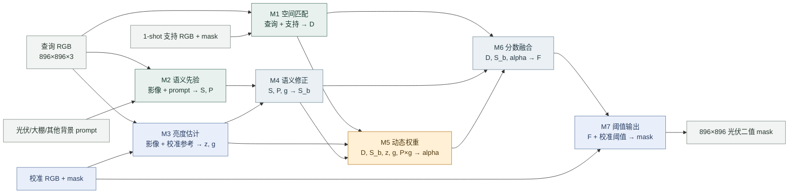

# 局部动态权重基线：模块关系

分支：`codex/pv-dynamic-alpha-baseline`

对应实验：`zh0416/pv-brightness-dynamic-fusion` Version 1

本页只描述模块边界、模块之间的数据关系和接口。图中不展开编码器、池化或网络层等内部步骤。后续新增或替换模块时，先更新本页的模块关系和 I/O；模块内部结构另建对应的子文档，避免主图变成实现细节流程。

## 模块关系图

`D` 是支持图产生的 DINO 前景/背景空间响应；`S` 是 GeoRSCLIP 光伏语义响应；`P` 是大棚竞争惩罚；`z/g` 是归一化亮度及其门控；`S_b` 是亮度修正后的语义响应；`alpha` 是局部语义融合权重；`F` 是连续融合分数，不是概率。

## 模块接口

形状使用 PyTorch `B×C×H×W`；所有 `56×56` 标量图均对应 DINO patch 网格。

| 模块 | 输入 | 输出 | 当前职责 |
|---|---|---|---|
| M1 空间匹配 | 查询 RGB、支持 RGB、支持光伏 mask | `D: B×1×56×56` | 冻结 DINOv3-SAT；从支持图建立前景/背景原型，为查询图提供空间响应 |
| M2 语义先验 | 查询 RGB、固定文本 prompt | `S, P: B×1×56×56` | 冻结 GeoRSCLIP；输出光伏语义分数和大棚竞争惩罚 |
| M3 亮度估计 | 查询 RGB、校准 RGB/mask | `z, g: B×1×56×56` | 从校准集拟合亮度参考；为查询图生成归一化亮度与门控 |
| M4 语义修正 | `S, P, g` | `P×g`、`S_b: B×1×56×56` | 按亮度调制大棚惩罚：`S_b=clip(S-P×g,-1,1)` |
| M5 动态权重 | `D, S_b, z, g, P×g` 及其差值/局部统计 | `alpha: B×1×56×56`，范围 `[0,1]` | 593 参数的局部网络，为每个位置预测语义分支权重；当前基线选中 step 160 |
| M6 分数融合 | `D, S_b, alpha` | `F: B×1×896×896` | 分别上采样后计算 `(1-alpha)D + alpha S_b` |
| M7 阈值输出 | `F`、校准分数和校准 mask | 校准阈值 `t`；`F≥t` 的二值 mask | 按支持选择校准阈值并生成最终光伏掩膜 |

## 训练与数据角色

- **训练集：**22 张影像及二值 mask（4 张正图、18 张负图）；分割损失通过 M6 的分数更新 M5。两路编码器和 CAM 输入保持冻结。
- **校准集：**12 张影像及 mask；用于 M3 的 Q75/Q95 亮度参考、M7 阈值，以及每 80 步的 checkpoint 选择。
- **支持集：**3 种保留的 1-shot 支持选择；每种各自为 M1 提供一个支持前景/背景原型，不是训练随机种子或集成。
- **查询集：**24 张已查看过的开发影像；模型与阈值锁定后才读取其 mask 计算指标，不参与训练或选择。

checkpoint 根据三种支持选择上的平均校准 micro-IoU 选择，本次局部动态权重选中 step 160。大棚是整图场景标签；FP 表示所有非光伏背景上的误报。

## 后续扩展

如果改变模块之间的连接或某个模块的输入/输出，更新本页关系图和接口表。需要查看内部计算时，按模块分别建立子文档，例如 `docs/modules/M1_spatial_matching.md`，在子文档中展开该模块内部结构；除非模块接口发生变化，不必改动主图。

对应实现：`pvseg/frozen_baselines.py`、`pvseg/greenhouse_prior.py`、`pvseg/brightness_gate.py`、`pvseg/dynamic_brightness_fusion.py`、`pvseg/losses.py` 和 `scripts/kaggle_dynamic_brightness.py`。完整实验记录见 [动态权重实验](PV_DYNAMIC_BRIGHTNESS_20261030.md)。

**权重文件状态：** 当前仓库没有 `local_selected.pt`。锁定记录中的 SHA256 为 `91d355ca014a325dc566d2229539f29bd5e9d0e75ccfbf4c7422edd26f7bafc5`；`weight_grids.npz` 是校准/查询图的 alpha 输出，不是模型 checkpoint。
