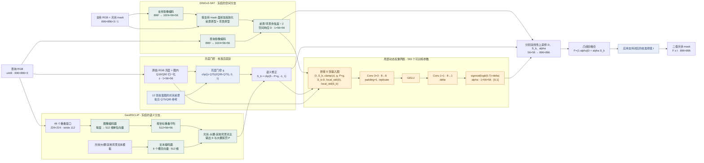
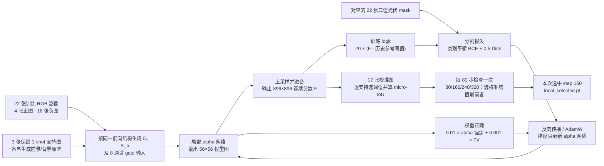

# 局部动态权重基线：模型结构与张量接口

版本：`codex/pv-dynamic-alpha-baseline`，基线代码提交 `b155cf7`

对应实验：`zh0416/pv-brightness-dynamic-fusion` Version 1

本文件是当前基线的结构图和模块接口说明。模型结构变化时，请在同一提交中同步更新流程图、I/O 表、训练流程和版本记录。Mermaid 图是可编辑的结构图源文件。

## 1. 单张查询的推理流程

图中 `D`、`S`、`P`、`z`、`g`、`S_b` 和 `alpha` 都在 DINO 的 `56×56` 网格上。输出分数 `F` 是余弦分数的凸组合，不是概率；阈值来自校准集。图中的冻结编码器不参与反向传播，训练只更新局部动态权重网络。

## 2. 训练与模型选择

checkpoint 按三种支持选择上的平均校准 micro-IoU 选择；每种支持各自有校准阈值。24 张开发查询图的掩膜只在 checkpoint 和阈值锁定后用于评估，不参与训练或选择。

> **权重文件状态：** 当前仓库没有 `local_selected.pt`。锁定记录中的 SHA256 为 `91d355ca014a325dc566d2229539f29bd5e9d0e75ccfbf4c7422edd26f7bafc5`。`weight_grids.npz` 保存校准/查询样本的预测 alpha 图，不是模型 checkpoint。

## 3. 模块 I/O 对照

张量形状采用 PyTorch `B×C×H×W`；图像像素大小写为 `H×W×C`。`B` 是批次维度。本次基线输入为 896×896，空间网格为 56×56。

| 编号 | 模块 | 输入 | 输出 | 用途与训练状态 |
|---|---|---|---|---|
| M0 | RGB 预处理与窗口生成 | 查询/支持 RGB：`896×896×3 uint8` | DINO 输入 `B×3×896×896`；Geo 窗口 `49×3×224×224` | 按各自预训练配置归一化；不训练 |
| M1 | DINOv3-SAT ViT-L/16 | DINO RGB；支持 mask `1×1×896×896` | 特征 `B×1024×56×56` | 编码器冻结；每个 patch 对应 16×16 像素 |
| M2 | 支持前景/背景原型 | 支持特征 `1×1024×56×56`；支持 mask `1×1×896×896` | 前景和背景原型各 `1×1024×1×1` | mask 面积下采样并加权池化，分别 L2 归一化 |
| M3 | DINO 空间响应 | 查询特征 `B×1024×56×56`；两类原型 | `D: B×1×56×56`，范围 `[-1,1]` | 查询 patch 的前景余弦减背景余弦，再除以 2；冻结 |
| M4 | GeoRSCLIP 图像窗口编码与坐标对齐 | 49 个 `224×224` 窗口 | 单窗向量 `49×512`；对齐网格 `B×512×56×56` | 单窗向量先归一化，再按覆盖坐标重叠平均；不重新归一化；冻结 |
| M5 | GeoRSCLIP 文本概念编码 | 光伏、大棚、屋顶、水面、裸地、植被 prompt 模板 | `6×512` 概念向量 | 同一冻结 Geo 文本编码器；模板向量归一化后求均值 |
| M6 | 大棚语义竞争先验 | Geo 网格 `B×512×56×56`；概念向量 `6×512` | 光伏语义 `S` 与有界大棚惩罚 `P`，均为 `B×1×56×56` | 仅当大棚概念胜过光伏和其他背景时产生惩罚；无新增可训练参数 |
| M7 | 亮度归一化与参考拟合 | 原始 RGB；校准 mask 的光伏 patch 面积 | `z: B×1×56×56`；固定 `Q75/Q95` 参考；门控 `g: B×1×56×56` | RGB 亮度图内 Q10/Q90 归一化；参考由正校准图拟合；推理时不读 query mask |
| M8 | 亮度调制语义修正 | `S`、`P`、`g`：各 `B×1×56×56` | 有效惩罚 `P×g`；`S_b=clip(S-P×g,-1,1)` | 固定运算；输出为修正后的语义分数 |
| M9 | 动态权重输入拼接 | `D`、`S_b`、`z`、`g`、`P×g` | `X: B×8×56×56` | 另外三张图为 `S_b-D`、`local_std(D)`、`local_std(S_b)`；所有输入 detach |
| M10 | 局部 alpha CNN | `X: B×8×56×56` | `alpha: B×1×56×56`，范围 `[0,1]` | `Conv3×3(8→8) → GELU → Conv1×1(8→1) → sigmoid(logit(0.7)+delta)`；593 个可训练参数 |
| M11 | 上采样与凸组合 | `D`、`S_b`、`alpha`：各 `B×1×56×56` | `F: B×1×896×896`，连续余弦分数 | 三者分别双线性上采样后融合；CAM 输入 detach，梯度只回到 alpha CNN |
| M12 | 校准阈值与二值输出 | 校准分数及 12 张校准 mask；查询分数 `F` | 每个支持选择的阈值 `t`；预测 mask `B×1×896×896` | 4096 桶、最大化校准 foreground micro-IoU；查询输出为 `F≥t` |
| M13 | 训练损失与正则 | 训练分数 `F`、训练 mask、`alpha` | 标量 loss | logit 为 `20×(F-历史参考阈值)`；类别平衡 BCE + 0.5 Dice + 0.01 alpha 锚定 + 0.001 TV |

## 4. 数据在各阶段的角色

| 数据角色 | 数量 | 可进入的模块 | 不承担的职责 |
|---|---:|---|---|
| 训练影像及 mask | 22（4 正、18 负） | 动态 alpha 网络的分割损失和正则 | 不用于推理阈值的最终选择 |
| 亮度校准影像及 mask | 12 | 拟合亮度 Q75/Q95 参考；按支持选择校准阈值和 checkpoint | 不进入 query 的前向模型作为 mask 输入 |
| 保留 1-shot 支持影像及 mask | 3 种支持选择 | 生成各自 DINO 前景/背景原型；定义校准和查询评估条件 | 不是 3 个训练随机种子，也没有集成预测 |
| 开发查询影像 | 24 | 前向推理、锁定后评估 | 查询 mask 不用于训练、阈值或 checkpoint 选择 |

“大棚场景”是整图分组，不提供大棚像素级真值；FP 表示全部非光伏背景上的误报。

## 5. 对应实现与同步规则

- 空间原型与响应：`pvseg/frozen_baselines.py`。
- 大棚语义对比：`pvseg/greenhouse_prior.py`。
- 亮度处理：`pvseg/brightness_gate.py`。
- 动态 alpha 与凸融合：`pvseg/dynamic_brightness_fusion.py`。
- 损失：`pvseg/losses.py`。
- 训练和阈值选择：`scripts/kaggle_dynamic_brightness.py`。
- 参数：`configs/dynamic_brightness_20261030.json`。
- 实验结果与验证：`docs/PV_DYNAMIC_BRIGHTNESS_20261030.md`。

后续修改结构时，更新本文件的两个 Mermaid 图和模块 I/O 表；在基线文档中保留指向本结构文档的链接。若新增分支、损失或改变数据角色，也一并更新第 4 节与结果限制说明。
