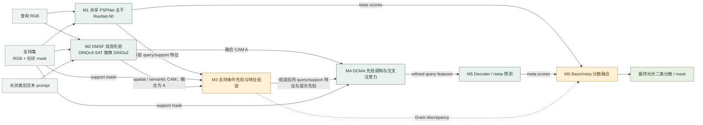
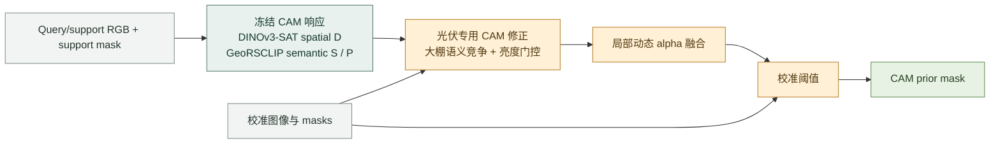

# SSPNet 光伏适配：模块关系与接口

分支：`codex/pv-dynamic-alpha-baseline`；当前最佳 CAM 先验实验：私有 Kaggle `zh0416/pv-brightness-dynamic-fusion` Version 1。

主图按 SSPNet 原文 Fig. 1 的模块边界重绘，只表示模块之间的关系；模块内部结构另行展开。完整光伏适配路径沿用论文的 SSPNet 主线，并标出项目替换与调整。当前最佳的局部动态权重结果来自一条独立 CAM 先验实验路径，尚未接入完整 SSPNet，因此单独说明。

## 完整 SSPNet 光伏适配

### 模块接口

`B` 为 batch size，`K` 为 support shot 数，图像张量按 `B×C×H×W` 表示。

| 模块 | 输入 | 输出 | 与原文及光伏实现的关系 |
|---|---|---|---|
| M1 共享 PSPNet 主干 | Query RGB；support RGB | Query/support 多层特征；query base scores | 原文使用预训练 PSPNet 的 ResNet-50 或 VGG-16，episodic 阶段冻结；本项目使用 ResNet-50 |
| M2 DMSF 双流先验 | Query/support RGB、support masks、类别文本 | Spatial CAM、semantic CAM、融合 CAM `A`、全局融合系数 | 原文 DINOv2 空间流 + GeoRSCLIP 语义流；本项目以 DINOv3-SAT 替换 DINOv2，保留可学习投影、CAM 修正和全局融合。基础编码器冻结 |
| M3 支持条件先验与特征组装 | M1 多层特征、support masks、`A` 与 `1-A` | Query/support 组装特征、前景/优势先验、support 权重与 Gram discrepancy | 按论文的多层先验选择与组装流程实现；多 shot 支持加权及 discrepancy 融合结合了 Gram 机制 |
| M4 DCMA | 组装后的 query/support 特征、support masks、融合 CAM `A` | Refined query features；训练用 pseudo-mask logits | 保留 CAM 调制与前景约束的支持/查询交叉注意力；pseudo-mask 仅作训练辅助，不并入最终预测 |
| M5 Decoder / meta 预测 | Refined query features | Meta 两类分数 | ASPP 与 meta prediction head，输出背景/光伏分数 |
| M6 Base/meta 分数融合 | Base scores、meta scores、Gram discrepancy | 最终两类分数；取 argmax 得到光伏 mask | 保留 base/meta 融合思想；已知单类光伏适配按背景、光伏类别分别融合 |
| Training supervision | Query GT；final/meta scores、pseudo-mask logits、spatial CAM | 标量训练损失 | GT 只在训练/评估使用，不作为推理输入。完整修正实验在论文式 CE、Dice、pseudo-mask、CAM 损失外增加 balanced raw-meta CE |

### 原文设计与本项目改动

| 位置 | SSPNet 原文 | 本项目当前实现 |
|---|---|---|
| 基础表征 | ResNet-50/VGG-16 + PSPNet；冻结的 DINOv2 与 GeoRSCLIP | ResNet-50 + PSPNet；DINOv3-SAT 替换 DINOv2；GeoRSCLIP 保留 |
| DMSF 融合 | 视觉/文本投影、互补空间与语义 CAM、单个全局可学习融合系数 | 完整 SSPNet 适配仍使用全局融合系数；局部动态 alpha 只在独立 CAM 实验中使用 |
| 任务设定 | base 与 novel 类互斥的遥感 few-shot segmentation | 已知光伏单类适配；训练阶段见过光伏标签，不是论文 novel-class 协议的严格复现 |
| 预测与监督 | DCMA 后解码，融合 base/meta 预测；辅助 pseudo-mask 和 spatial CAM 监督 | 保留主干流程；完整修正实验另加 balanced raw-meta CE，以缓解光伏前景漏检 |

### 独立 CAM 先验实验

这条实验路径**没有接入 M4 DCMA、M5 decoder 或 M6 base/meta 融合**。当前报告的 **51.26% IoU** 是 24 张开发图上的 CAM prior 结果，不是端到端 SSPNet 指标；完整 SSPNet 修正实验的 final 输出在校准阈值下，于 58 张统计查询上达到 **21.73% IoU**。两者的输出范围与实验路径不同，不能直接作为同一模型版本对比。详见[动态权重实验](PV_DYNAMIC_BRIGHTNESS_20261030.md)和[A3 完整评估](A3_REPAIRED_RESULTS_20261030.md)。

## 后续维护

新增、替换或连接模块时，先同步更新完整结构图与接口表。需要查看内部层级时，再为对应模块增加子图；DCMA 内部结构可参考原文 Fig. 2（PDF 第 6 页）。本文总图对应原文 Fig. 1（PDF 第 4 页），模块组织参考 Section III-B 至 III-D；图为重绘，不是论文插图的复制。

参考文献：Yi Zhong and Guodong Zhao, “SSPNet: Spatial-Semantic Foundation Prior Network for Remote Sensing Few-Shot Segmentation,” IEEE Journal of Selected Topics in Applied Earth Observations and Remote Sensing, DOI: `10.1109/JSTARS.2026.3745987`。

对应实现：`pvseg/sspnet/model.py`、`pvseg/sspnet/modules.py`、`pvseg/sspnet/losses.py`；独立 CAM 实验实现：`pvseg/brightness_gate.py`、`pvseg/dynamic_brightness_fusion.py`、`pvseg/greenhouse_prior.py`、`scripts/kaggle_dynamic_brightness.py`。
