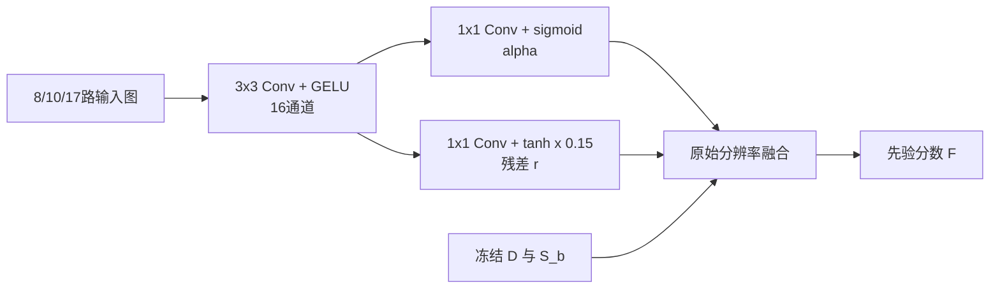
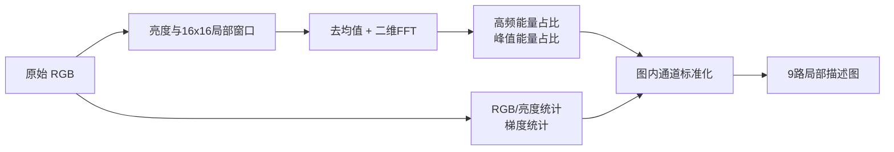

# 背景误检校正：模块结构与接口

这次迭代扩展独立 CAM 先验路径。原 SSPNet 模块总图见 [PV_DYNAMIC_ALPHA_ARCHITECTURE.md](PV_DYNAMIC_ALPHA_ARCHITECTURE.md)；当前分支 `codex/pv-hard-negative-spatial`，旧基线分支保留。完整 DCMA、decoder 与 base/meta 融合仍未接入本次实验。

总图中的纹理模块按实验配置启用；8通道残差方案不需要它。所有输出仍是先验分割，接入完整 SSPNet 是后续集成任务。

| 模块 | 输入 | 输出 |
| --- | --- | --- |
| 冻结双流 CAM | Query/support RGB，support光伏mask，光伏/背景文本概念 | DINO响应 D、Geo光伏语义 S、大棚竞争惩罚 P：各 B×1×56×56 |
| 语义与亮度修正 | 原始RGB亮度图 z/g，S，P | S_b=clip(S−P×g,−1,1)；原8路融合输入 X：B×8×56×56 |
| 局部纹理描述 | Query 原始 uint8 RGB：896×896×3 | 2路FFT能量比 + 7路RGB/亮度/梯度描述：B×9×56×56；每通道图内标准化 |
| 融合与残差校正 | X；可选纹理图 | alpha∈[0,1]、残差 r∈[−0.15,0.15]：各 B×1×56×56 |
| 校准与输出 | D、S_b、alpha、r；校准集选择的阈值 | 四项各自双线性上采样到896后，F=(1−alpha)D+alpha S_b+r；F≥阈值得到光伏mask |

GT 不进入预测接口；训练时使用掩膜，校准时使用独立校准组掩膜。`scripts/predict_hard_negative.py` 的推理函数没有 query mask 参数。

## 校正模块内部

alpha 初始0.7、残差初始0；因此训练起点与旧固定权重相同。两个编码器与亮度规则冻结。残差可以在两路响应都高时降低背景响应，也可以补回两路响应都低的位置；是否有用由有监督训练与空间组留出结果检验。

## 频域模块内部

这里是常规局部描述子，不预先声称原创。16×16窗口没有新增图像细节；对低分辨率影像中不可见的组件板缝，FFT也无法恢复。纯频谱与去FFT对照用于判断增量信息是否存在。

## 后续修改约定

总图只改模块间数据流；新增通道、缩放、输入类型和训练范围记录在接口表；模块内部另绘对应小图。实验结果与模型选择写入 [结果记录](PV_HARD_NEGATIVE_RESULTS_20261101.md)，更新图不等于自动替换已验证的基线。
