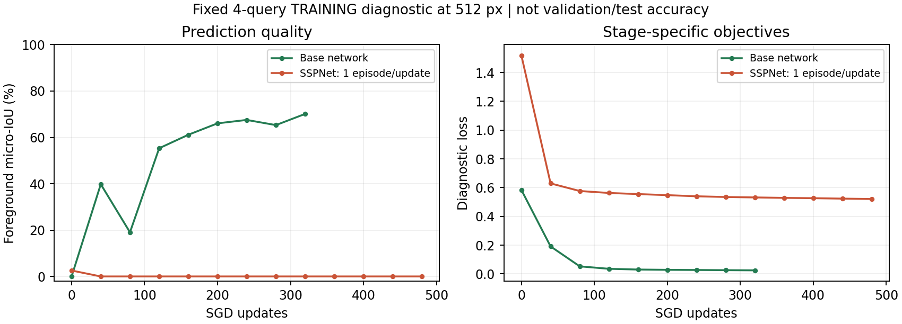
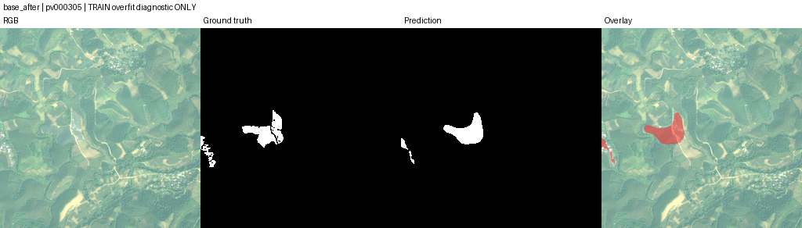
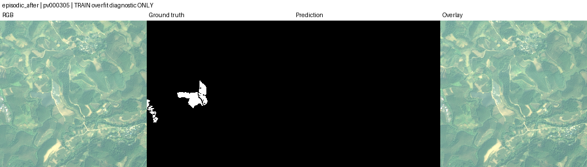

# SSPNet 两阶段小样本收敛与恢复检查（2026-10-28）

## 检查范围

本次完成恢复逻辑修复，并用用户已有的 896×896 光伏数据检查模型能否在固定训练样本上学习。输入先缩放到论文使用的 512×512；原生 896×896 另做一次完整前向／反向。没有更换数据集，没有启动正式全量训练。下述 IoU 均为**训练集诊断的光伏前景 micro-IoU**，不是独立验证精度，也不是原论文的多类别 mIoU。

## 1. 续训修复：通过

- 检查点内嵌完整历史，使用临时文件写完后原子替换。恢复以检查点为准继续追加历史；旧格式必须能读取完整相邻历史。
- 恢复前校验训练阶段、划分、尺寸、shot、学习率、batch、累积、总 epoch、max-steps、seed、workers、注意力分块、路由和精度等设置。不兼容时先报错，再进入实验元信息写入步骤。
- 已有实验目录必须显式恢复；已完成实验须使用新目录，避免覆盖。
- 本地共 24 项测试通过。中断回归测试模拟“检查点保存成功、history.json 尚未写入”时退出；恢复与连续训练的参数、优化器、随机状态、历史完全一致。
- 真实 T4 单步恢复：基础网络参数最大绝对差 `3.05e-7`，第二阶段 `9.31e-9`；重做一步的损失相同、AMP scaler 和 Torch/CUDA 随机状态一致，均低于预设 `1e-6` 容差。GPU 浮点检查不能声称逐 bit 相同。

修复提交：`3b7d9fb85b699007863c10e11343aae7634be771`。证据见 [base 恢复探针](experiments/sspnet_convergence_20261028/microbatch1/base_resume_probe.json) 与 [第二阶段恢复探针](experiments/sspnet_convergence_20261028/microbatch1/episodic_resume_probe.json)。

## 2. 数据与第一轮收敛检查

来源为 `zh0416/pv-896`。固定选取原训练侧 4 张查询：2 张普通正样本、1 张困难正样本、1 张负样本；关闭增强。支持是训练侧空间隔离的固定 1-shot，查询与支持均不接触验证侧。缩放后 3 张正样本仍有前景，32×32 DINO patch 网格分别保留 46、61、22 个前景位置，排除了前景因缩放完全消失的情况。

| 查询 | 类别 | 512² 前景占比 | 支持 ID | 基础网络训练后 IoU |
| --- | --- | ---: | --- | ---: |
| pv000015 | 正样本 | 3.715% | pv003499 | 68.43% |
| pv000059 | 正样本 | 6.224% | pv000886 | 72.00% |
| pv000305 | 困难正样本 | 1.896% | pv000059 | 67.09% |
| pv001366 | 负样本 | 0 | pv000566 | 无前景联合区域，IoU 不定义；误报 0 像素 |

两阶段均用 SGD（lr .005，momentum .9，weight decay 1e-4）、恒定学习率、batch 1、梯度范数截断 10。第一阶段冻结 BN 运行统计，第二阶段冻结 CNN 与真实 DINOv3-SAT，保持论文重建的四项损失。

| 阶段 | 更新数 | 诊断损失：前 → 后 | 最终输出 IoU：前 → 后 | meta IoU：后 | 判定 |
| --- | ---: | --- | --- | --- | --- |
| PSPNet 基础网络 | 320 | 0.58406 → 0.02504 | 0 → 70.13% | 不适用 | 通过限定检查 |
| SSPNet 第二阶段 | 480 | 1.51921 → 0.52108 | 2.56% → 0 | 0 | 未通过，3 张正样本全部漏检 |

损失降低不足以证明有效。第二阶段最终预测全部为背景，meta Dice 在 3 张正样本上约为 0.50–0.52；native 探针的 meta 预测头梯度约 `1e-9`。预测图与数值一致，不能把“训练成功退出”作为收敛通过。

第一轮源码为 `3b7d9fb`，运行见 [Kaggle 第一轮诊断](https://www.kaggle.com/code/zh0416/sspnet-pv-convergence-check?scriptVersionId=363101223)。完整小报告在 [microbatch1](experiments/sspnet_convergence_20261028/microbatch1/)，包含数据审计、逐图计数、四项损失、梯度、历史、环境和恢复探针。

曲线同时展示预测质量与损失；两阶段目标函数不同，损失绝对值不直接横向比较：

### 预测核对

以下均为训练集诊断缩略图，列依次为 RGB、真实掩膜、预测、叠加。

基础网络的困难正样本有正确响应，但轮廓粗糙，局部有漏检及外扩：

第二阶段同一张图全部输出背景：

## 3. 896×896 兼容性：通过单次检查

同一真实权重模型在 `pv000015` + `pv003499` 上完成 896² 前向、原损失、反向传播与梯度有限性检查。学习率为 0，仅测试兼容性；冻结参数无梯度。

- 损失 `0.68210`。
- PyTorch 峰值 allocated `2,385,631,744` 字节，约 **2.22 GiB**。
- 峰值 reserved `2,617,245,696` 字节，约 **2.44 GiB**。
- 此显存不代表所有图像、batch、5-shot 或第一阶段训练的显存需求。单次可运行也不等于已证明 896² 下能收敛。

证据：[原生尺寸检查](experiments/sspnet_convergence_20261028/microbatch1/native_896_probe.json)。

## 4. 对照检查

第一轮后增加每次累积 4 个 episode 的对照，保持样本、支持、基础权重、原模型与损失一致，从基础检查点保存的 RNG 状态重新初始化第二阶段；记录逐图 meta 概率、logit 范围和 meta IoU，检查是否发生概率饱和。累积更新不是与论文真实 batch 4 的严格等价证明。

对照源码 `2bd203f`，运行：[Kaggle 累积对照 v1](https://www.kaggle.com/code/zh0416/sspnet-pv-accumulated-check)。上限 320 次 SGD 更新，即最多 1280 个 episode 暴露次数；第一轮是 480 次更新／480 个 episode，因此不能将两者差别完全归因于累积数。

最后成功读取的日志如下，属于**中途观测**：

| 更新数 | 诊断损失 | final IoU | meta IoU |
| ---: | ---: | ---: | ---: |
| 40 | 0.62963 | 0 | 0 |
| 80 | 0.57653 | 0 | 0 |
| 120 | 0.56270 | 0 | 0 |
| 160 | 0.55444 | 0 | 0 |

随后本地日志流中断。多次通过代理、直连及 Kaggle 官方网页/API 重读均超时，尚未取回该轮最终 JSON 与预测图，因此**不确认其最终状态，也不将中途数值作为最终结果**。证据见 [对照中途观测](experiments/sspnet_convergence_20261028/accumulation4/partial_observation.json)。首轮完整结果已归档；恢复连接后只需读取此 v1 现有产物，无需重复提交训练。

## 当前结论与后续

第 1 步恢复修复已完成并通过；第 2 步首轮真实数据检查已完成，但第二阶段未通过，补充对照最终报告尚未取回。基础分割器可学习，现有 896² 数据可继续使用。24 项测试和真实前向／反向证明的是已覆盖行为，不能证明代码绝对无误，亦不能替代收敛和泛化实验。

后续先定位第二阶段：在固定 episode 上逐步记录 meta logits、前景／背景概率和预测头梯度，并用相同初始化做短程 FP32 对照，区分数值饱和与目标函数／融合优化问题；若引入预测头归一化、预热或类别重加权，须单独标记为改进方案，保留原损失对照。当前证据尚未定位唯一原因，也未证明这些改动有效。

进入正式实验前，限定检查要求 final 与 meta 前景 micro-IoU 均至少 0.60、损失低于初始值、每张正样本均有真阳性，并继续报告负样本误报。该门槛仅是本项目的工程排查标准。单类别光伏适配使用像素掩膜监督，不能替代原论文的基类／新类不相交实验或弱监督实验；尚未启动正式 25 epoch 训练。
