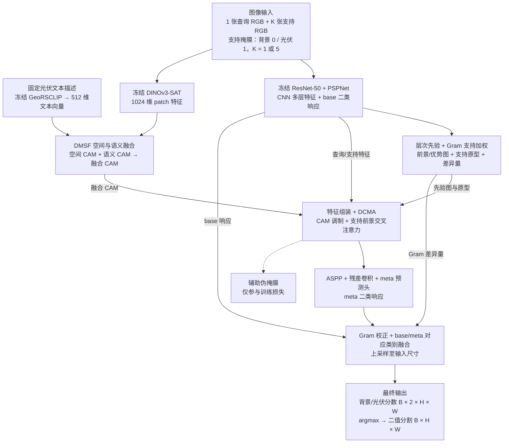

# SSPNet-DINOv3 光伏适配实现

本实现根据 Zhong 与 Zhao 的 SSPNet 论文（DOI: 10.1109/JSTARS.2026.3745987）重建方法，使用用户已保存在 Kaggle 的 DINOv3-SAT 替换 DINOv2。没有找到可核验的作者官方代码，因此这是**论文方法重建与单类别光伏适配**，不能称为官方逐行复现，也不能声称复现了论文的指标。

**2026-10-28 验证状态：Kaggle 第 3 版真实权重工程检查通过。** 21 项行为测试通过，两阶段各完成 2 次参数更新，正／困难正／负查询的 5-shot 推理正常。验证源码包含 GeoRSCLIP QuickGELU 修正。输入为 512²；尚未充分训练，也未验证 896²，见 [实际运行记录](SSPNET_SMOKE_20261028.md)。

## 结构图与模块作用

**阶段一：** 训练 RGB 图像 + 真实像素掩膜 → ResNet-50 + PSPNet 二类分割预训练 → 保存基础分割器。阶段二冻结该分割器及 DINOv3-SAT，训练先验融合、注意力与分割预测模块。

**阶段二主路径（按当前光伏适配代码绘制）：**



支持掩膜同时用于 DMSF、层次先验／支持原型和 DCMA，图中省略其重复连线。文本向量可预先缓存；进入模型后，文本映射层仍参与训练。

### 输入与输出

| 项目 | 形状与含义 |
| --- | --- |
| 查询图 `query_rgb` | `[B, 3, H, W]`，待分割 RGB，数值范围 `[0,1]` |
| 支持图 `support_rgb` | `[B, K, 3, H, W]`，提供光伏外观参考，`K=1/5` |
| 支持掩膜 `support_masks` | `[B, K, 1, H, W]`，背景 0、光伏 1；每张支持图必须有光伏前景 |
| 最终分数 `logits` | `[B, 2, H, W]`，通道 0 为背景、通道 1 为光伏；按通道取 `argmax` 得到二值分割 |
| 查询真值 | 只在训练损失和评估指标中使用，**不传入推理模型** |

`B` 为批大小。当前验证尺寸 `H=W=512`：DINO 特征为 `32×32`，CNN／DCMA 主特征为 `64×64`，最终分数恢复到 `512×512`；原始 `896×896` 输入尚未运行验证。

### 各模块做什么

| 模块 | 输入 → 输出 | 作用 |
| --- | --- | --- |
| ResNet-50 + PSPNet | 查询／支持 RGB → 多层 CNN 特征；查询 base 二类响应 | 提供局部纹理与分割特征，并保留第一阶段学到的光伏分割能力；第二阶段冻结 |
| DINOv3-SAT | 查询／支持 RGB → 1024 通道、步长 16 的特征图 | 提供遥感预训练视觉表示，替换原文 DINOv2；冻结权重 |
| GeoRSCLIP 文本编码 | 固定光伏描述 → 512 维向量 | 提供“光伏是什么”的语义参照；冻结编码器，缓存原始向量 |
| DMSF | DINO 特征 + 支持掩膜 + 文本向量 → 空间、语义及融合 CAM | 用支持前景原型寻找外观相似区域，用可训练文本映射寻找语义相关区域，再学习融合两种提示 |
| 层次先验 | 两层 CNN 特征 + 支持掩膜 → 前景相关图、前景优势图 | 从 block4 与 PSP 特征中选择相关图；用前景相对背景的优势抑制混淆区域。默认选择规则仍有近似平局疑点 |
| Gram 支持加权 | 查询／支持低层特征 + 支持前景原型 → 每张支持的权重、加权原型与差异量 | 衡量查询和支持的特征统计差异，聚合由支持掩膜提取的前景原型，并向最终融合提供差异量；5-shot 加权层需要训练 |
| 特征组装 + DCMA | CNN 特征、原型、先验／CAM、支持掩膜 → 256 通道增强特征及辅助伪掩膜 | 将线索汇入查询／支持特征，用 CAM 调制查询，再通过支持前景交叉注意力传递光伏信息；辅助头提供训练监督 |
| ASPP + 残差卷积 + meta 头 | 增强特征 → meta 二类响应 | 汇集不同尺度的上下文，生成支持条件下的光伏分割响应 |
| Gram 校正 + base/meta 融合 | meta 响应、Gram 差异量、base 响应 → 输入尺寸的最终二类分数 | 校正 meta 响应，并按背景／光伏对应类别融合基础预测；这是单类别光伏适配，不是原文新类协议的直接照搬 |

第二阶段训练使用 `CE_final + Dice_meta + 0.2 BCE_pseudo + 0.04 Dice_spatial_CAM`。其中伪掩膜和空间 CAM 是辅助监督，最终分割来自图中的 base/meta 融合输出。

## 已实现的完整路径

1. ImageNet 初始化的 ResNet-50 / output stride 8 / PSPNet，在训练空间分组内进行二类有监督分割预训练。
2. 冻结 PSPNet 与 DINOv3，用训练图及其真实掩膜构造 1-shot 或 5-shot 支持集；查询图可包含无光伏的负样本。
3. DMSF：最后一个 DINO patch 特征 → 共享 Linear/LN/GELU 投影 → 支持前景原型产生空间 CAM；GeoRSCLIP 固定文本向量 → 三层跨模态映射 → 隐层投影产生语义 CAM；两个 CAM 分别进行有界残差修正；单个全局标量 sigmoid(beta) 融合，beta 初始为 0.7。
4. 在 CNN block4 与 PSP 分类器前的 512 通道特征之间，按论文 Eq. 10–12 选择前景与前景优势相关图。
5. 组装查询／支持特征，DCMA 进行 [1,1.1] 倍 CAM 调制、8 头有前景掩膜的 cross-attention、残差/LN/FFN；辅助头输出 [-5,5] 的伪掩膜 logits。
6. ASPP + 残差卷积 + meta 二类预测，经 Gram 支持权重及基学习器融合得到最终预测。
7. 损失为 `CE_final + Dice_meta + 0.2 BCE_pseudo + 0.04 Dice_spatial_CAM`。辅助伪掩膜只参与训练损失，不融合进最终预测。

推理接口严格为 `model(query_rgb, support_rgb, support_masks)`，不接收查询真值。评估标签只在模型外计算损失与指标。

## 与原论文的差异及原因

| 项目 | 当前实现／含义 |
| --- | --- |
| 任务 | 单个已知前景“光伏”与背景；文件夹的正／负／困难正样本不是三个语义类别 |
| 监督 | 两个训练阶段均使用真实像素掩膜；不是弱监督，不是仅总计 1/5 张标注 |
| 基类／新类 | 没有多类别 base→novel 不相交划分；PSPNet 已见过光伏标签 |
| 基学习器融合 | 按背景／光伏分别合并对应的 base/meta 响应；不能把同一个光伏基类当作“其他基类”来压制光伏前景 |
| DINO | ViT-L/16，最后一个 block 23，1024 维；原论文 ViT-B/14。SAT493M 是预训练标记，实际骨干约 303M 参数 |
| CNN stem | torchvision ResNet-50 的标准 7×7 stem；BAM 参考代码使用自定义深 stem。论文未给出足够实现细节，此处明确采用可维护的 torchvision 版本 |
| PSPNet | PPM bins 1/2/3/6，分类头 512 维；batch=1 时冻结 BN 运行统计，BN 仿射参数在第一阶段仍可学习 |
| 输入 | 原图严格校验 RGB BMP 896²、掩膜 0/255；首次实验 resize 到 512²，标签 nearest，不扩充或虚构小目标 |
| 归一化 | DINO SAT mean [.430,.411,.296] / std [.213,.156,.143]；CNN 使用 ImageNet 参数；二者均从同一份 [0,1] RGB 独立计算 |
| 文本 | 固定光伏遥感描述，见 `PV_PROMPT`；新增类别 prompt，不是论文原有类别文本 |
| 5-shot | DMSF 空间 CAM 等权平均，层次相关图按论文等权平均；CNN 原型用 Gram 权重。具体多 shot 细节无官方代码可核实 |
| Dice | meta 两类 Dice 等权平均，前景权重默认 1；不自动迁移 LoveDA 类别的 2 倍启发式权重 |
| 训练 | SGD .005 / .9 / 1e-4，poly .9，默认 25 epoch；batch=1 累积 4 次，不能宣称与论文 batch=4 完全等价 |
| 增强 | 同步翻转／90°旋转；尚未加入论文中的随机裁剪、颜色增强，避免初版裁剪消除微小支持前景 |
| attention | PyTorch SDPA，按查询 token 分块，使用同一 -1000 掩膜公式，不显式保存全尺寸 attention 矩阵 |

三层文本映射宽度、CAM 修正隐藏宽度（16）、FFN 4 倍扩展、dropout 等为透明的重建选择，不能假装是已核验的原作者设置。

## 层次选择的论文歧义

论文先对两层相关图分别 min-max，再比较各自最大值。非恒定图的最大值通常都接近 1，路由可能受 epsilon 和浮点差异影响。默认 `--routing literal` 保留该顺序，并记录 `near_tie`、`base_selected`。`--routing raw_max` 是显式实验选项，改为比较归一化前响应；不能将其指标归为严格原方法。

伪掩膜头最后一层零初始化，因此**第一次反向传播**的该项损失只能先更新末层，上游梯度在末层更新后才出现。单元测试检验了第二步的语义投影梯度；不把计算图可达性当成准确率提升的证明。

## 数据隔离

复用 `pvseg.spatial`：共享源图名、图像 hash 或空间相交的场景合并后，先分训练／验证组。`--pilot` 重用旧的最多 60 对开发集；默认使用同一空间分组下的全部样本。两阶段必须使用完全相同的 ID 划分 hash。

每个 episode 的支持图必须来自训练侧、与查询分属不同空间组、ID 与 hash 不同、足迹不相交；5 个支持之间也不能相交或重复。支持前景在模型输入与 DINO patch 网格消失时跳过该候选，若剩余不足则明确报错。负查询允许空掩膜，支持图不允许无前景。

验证支持选择由 seed 固定并写出每张查询的支持 ID；训练每 epoch 更新采样。现有 16 个来源场景已用于此前开发，**该验证集不是新的独立测试集**，正式研究需要另留未参与开发的区域／来源。

## 权重与运行位置

代码与配置保存在 GitHub。原始图像、预训练／训练权重、运行产物仅留 Kaggle；不下载到本地仓库。

- SAT：原计划从 notebook v4 的 `verified_sat/model.safetensors` 与相邻 `config.json` 挂载。API 实际解析到缺少该文件的归档后，本次在 Kaggle 内恢复了相同权重；后续可挂载 SSPNet 第 3 版输出中的 `sspnet_assets/verified_sat/`，传入实际挂载路径。
- SAT SHA256：`8d18337f766102f951ac0ca543a22536f58caeb6b6c33cfef73326f866791286`。
- GeoRSCLIP：`Zilun/GeoRSCLIP` revision `4920188e6eba4e711ef9848cfd7cb77e874ee33f`，仅 `ckpt/RS5M_ViT-B-32.pt`。
- Geo SHA256：`129bafaa6a097b8be52e2babf27d24f0a934dae919201e538dc698611bd1ea01`。
- 只缓存冻结文本编码器的原始 512 维向量，学习投影每步重新计算。完整 CLIP 可在缓存后释放；缓存保存 prompt 和源权重 hash。
- GeoRSCLIP 使用其 OpenAI CLIP 初始化对应的 QuickGELU；只核对权重键名不足以发现 GELU／QuickGELU 激活不一致，因此显式指定并记录。
- PSPNet 第一阶段 checkpoint 包括全模型；第二阶段 checkpoint 包括冻结 CNN、原始文本向量、全部可训练模块、优化器、AMP scaler、随机状态与配置，省略已有 hash 校验的 SAT 权重。

## Kaggle 中的命令

先运行 `python scripts/kaggle_sspnet.py` 完成下载／缓存、真实权重工程检查。该入口只做第一、二阶段各 2 次更新和 5-shot 推理，不能作为准确率实验。

正式训练使用新输出目录，首次从冻结文本缓存与已挂载 SAT 权重开始：

下例的 SAT 路径仅在原 v4 确实挂载时成立；也可使用已恢复的 `/kaggle/working/sspnet_assets/verified_sat/model.safetensors`。在新 session 中应挂载第 3 版资产，替换成实际 `/kaggle/input/.../sspnet_assets/...` 路径。文本缓存同理，不要引用已经结束的 session 的 working 目录。

```bash
python scripts/sspnet.py base --data-root /kaggle/input --output /kaggle/working/sspnet_base --epochs 25 --size 512 --batch-size 1 --accumulation 4

python scripts/sspnet.py episodic --data-root /kaggle/input --output /kaggle/working/sspnet_1shot --base-checkpoint /kaggle/working/sspnet_base/last.pt --weights /kaggle/input/notebook5f7aef8a4f/verified_sat/model.safetensors --text-cache /kaggle/working/sspnet_assets/georsclip_pv_text.pt --shots 1 --epochs 25
```

5-shot 使用 `--shots 5` 和独立输出目录重新训练其 reweight 模块。检查点推理评估使用相同结构、划分与依赖：

```bash
python scripts/sspnet.py evaluate --data-root /kaggle/input --output /kaggle/working/sspnet_eval --base-checkpoint /kaggle/working/sspnet_base/last.pt --weights /kaggle/input/notebook5f7aef8a4f/verified_sat/model.safetensors --text-cache /kaggle/working/sspnet_assets/georsclip_pv_text.pt --shots 1 --resume /kaggle/working/sspnet_1shot/last.pt
```

输出包含逐 epoch 四项训练损失、整体验证与分组 IoU/F1/误报/漏检指标、支持 ID、路由统计、依赖版本、划分与检查点。`--resume` 支持 epoch 边界恢复；训练恢复校验 stage、size、shots、划分、学习率、batch、累积、总 epoch、max-steps、seed、workers、query-chunk、routing、pilot、工程模式及精度策略。不支持将半个 epoch 当成完整 epoch 恢复。首版保存 `last.pt`，不自动挑选最优模型或进行超参数搜索。

检查点通过同目录临时文件原子替换，并内嵌截至该 epoch 的完整历史；恢复后继续追加，不重新建立空日志。旧检查点需有相邻且完整的 `history.json`。配置／模型依赖／历史检查通过前不写实验元信息；已有未完成目录须显式 `--resume`，已完成目录须使用新路径。本地回归测试模拟在保存检查点后、写 JSON 前中断，验证恢复与连续训练的参数、优化器、随机状态和历史一致，并检查不兼容的恢复不会覆盖元信息。

小样本收敛诊断入口为 `python scripts/kaggle_sspnet_convergence.py`：从原训练划分固定选取 2 张正样本、1 张困难正样本、1 张负样本，关闭增强，在 512² 下分别进行最多 320／480 次更新；支持仍来自空间隔离的训练图。检查前景与 meta IoU、损失、各模块梯度、真实 GPU 单步断点恢复，并另做一次 896² 原尺寸前向／反向兼容检查。其阈值仅用于排查能否学习，输出保存在 `sspnet_convergence/`，不代表验证集精度；第一阶段诊断权重始终标记为 `engineering_only`。运行需挂载原数据集与 SSPNet 第 3 版的权重／文本缓存输出。

梯度范数截断为 10，也是首版工程设置。Kaggle API 可能把带 `/4` 的 notebook 输入解析为较新归档版本；若归档没有 SAT 文件，检查入口会只在 Kaggle 内从固定 HF revision 恢复相同 SHA256 的权重，并保存恢复记录与实际文件供后续挂载。

`--max-steps` 和 `--allow-untrained-base` 明确标记工程检查。仅运行两步的 PSPNet 会被标记 engineering_only，不能在未显式允许工程模式时冒充合格的第一阶段模型。

## 验证与引用

本地验证：`python -m unittest discover -s tests -v`，包含独立于预训练权重的数值、梯度、空掩膜、隔离、1/5-shot、checkpoint 测试。真实编码器 GPU 验证以 Kaggle 输出为准。

Gram discrepancy、排序后 k-shot reweight 和 learner merge 的参考来自 [chunbolang/BAM](https://github.com/chunbolang/BAM) 的 `model/BAM.py` 与 `model/PSPNet.py`，保留 MIT 许可于 `third_party/BAM-LICENSE`。未引用其结果作为本实现结果。GeoRSCLIP 来自 [RS5M](https://github.com/om-ai-lab/RS5M)；各上游权重许可仍适用。
